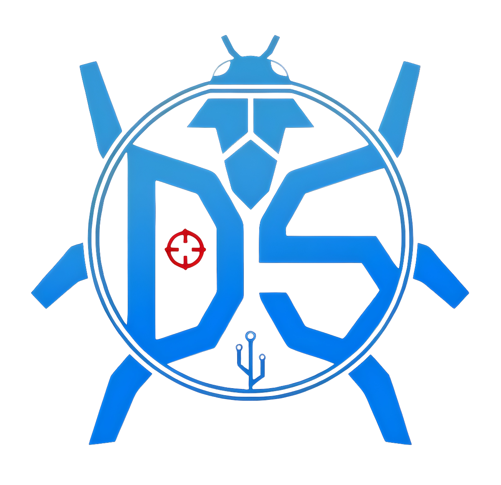

<p align="center">
  
</p>

<h1 align="center">The Debugging Society</h1>

<p align="center"><b>We teach, code and compete.</b><br />The coding society of Netaji Subhas University of Technology, Delhi.</p>

<p align="center">
  <a href="https://www.instagram.com/thedebuggingsocietynsut/">Instagram</a> ·
  <a href="https://www.linkedin.com/company/thedebuggingsocietynsut/">LinkedIn</a> ·
  <a href="https://chat.whatsapp.com/GQThHbXdSpT68iHm2nT8Dx">Join our WhatsApp community</a>
</p>

---

## Who we are

The Debugging Society (TDS) is a student-run coding society at NSUT. We started with one goal: to build a real passion for coding through regular assignments, weekly quizzes, and a network of people who care about technology.

Today TDS is where NSUT students come to get better at problem solving, build things, and prepare for what comes after college.

## What we teach

- **Data Structures & Algorithms**
- **Competitive Programming**
- **Web Development**
- **Interview Preparation**
- **Android Development**
- **C++ and Java**

From first-year fundamentals to placement season, our weekly assignments and quizzes keep members practising.

## Events we've hosted

- **CTRL+ALT+HACK**: a 24-hour hackathon built around Generative AI, machine learning and Web3
- **AI: Ethics & Security Conclave**: industry speakers and hands-on sessions, with IEEE NSUT
- **Matiks League 2026**: a seven-day online league of daily logic and speed challenges
- **Tech4Impact 2025**: a hackathon where tech meets sustainable impact
- **Data Sphere**, **Web-a-Thon** and **AI Horizon** at SpaceCon: data analytics, frontend design and generative AI challenges

## Where our alumni are

The people who ran TDS have gone on to **Google, Microsoft, Amazon, Apple, Uber, Atlassian, Morgan Stanley, American Express, BlackRock, Bain, Visa, Intuit** and more.

## Join us

New events and recruitment are announced in our **[WhatsApp community](https://chat.whatsapp.com/GQThHbXdSpT68iHm2nT8Dx)** first. Follow us on **[Instagram](https://www.instagram.com/thedebuggingsocietynsut/)** and **[LinkedIn](https://www.linkedin.com/company/thedebuggingsocietynsut/)** to keep up.

---

<details>
<summary><b>Working on this website</b></summary>

```bash
pnpm install
pnpm dev      # local dev server
pnpm build    # production build
```

Site content lives in `src/data/` as JSON (team, alumni, events, resources, president's message). Images go in `public/` with lowercase filenames that exactly match the JSON.

</details>

<p align="center">Built by the TDS Tech Team.</p>
